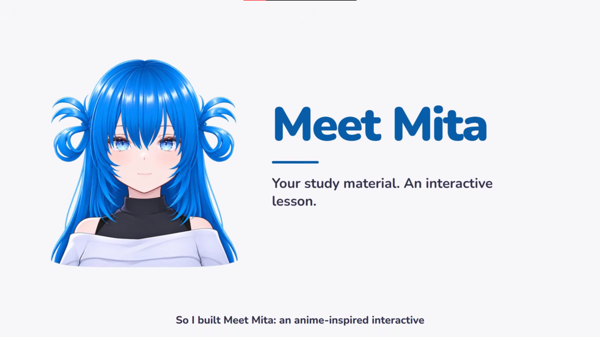

<h2>⭐ Featured</h2>
<table>
<tr>
<td width="50%" valign="top" align="center">

<h3><a href="https://github.com/hrodge107/MeetMita">🎓 Meet Mita</a></h3>
  

Meta Global AI Developer Hackathon entry. Upload a PDF or photos of your notes and Mita, a 3D learning companion, turns them into an interactive lesson with recall checkpoints, AI picture cards, and a Raise Hand feature for questions grounded in your own material.

<a href="https://github.com/hrodge107/MeetMita"><b>Repo</b></a>
</td>
<td width="50%" valign="top" align="center">

<h3><a href="https://akasha-zero.vercel.app">📚 AkashaZero</a></h3>
  

Installable PWA for notes that pair an image with markdown, organized as Series → Chapter → Note Card. Everything lives as plain files in your Google Drive, with background OCR, full-text search, a Ctrl+K palette, and offline reading.

<a href="https://akasha-zero.vercel.app"><b>Live</b></a>
</td>
</tr>
</table>

<h2>🗂️ More Projects</h2>

<b>🌐 Web</b> (2)

 

<table>
<tr>
<td width="33%" valign="top" align="center">
 
<b><a href="https://github.com/hrodge107/DevDive">🌐 DevDive</a></b> 
 
E-learning platform for HTML, CSS & JS with a built-in IDE and auto-checking.
</td>
<td width="33%" valign="top" align="center">
 
<b><a href="https://mapilisan-obe-marinebiodiversity.pages.dev/">🦈 Marine Biodiversity</a></b> 
 
Showcase of the Philippines' marine biodiversity and why it matters.
</td>
</tr>
</table>

<b>🎮 Games</b> (3)

 

<table>
<tr>
<td width="33%" valign="top" align="center">
 
<b><a href="https://github.com/hrodge107/ConsoleRPGAdventure">🎮 Console RPG Adventure</a></b> 
 
Turn-based console RPG with QTE combat, roles, and ASCII art.
</td>
<td width="33%" valign="top" align="center">
 
<b><a href="https://gd.games/games/b6d9f9ad-26b1-4051-983d-e2ae0b0cf65e">🕳️ Cavern Run</a></b> 
 
My first game (Grade 11), the one that got me into programming.
</td>
<td width="33%" valign="top" align="center">
 
<b><a href="https://drive.google.com/file/d/1pYCrO9FK41QRGRNH2ahu1oHtjH196IBi/view?usp=sharing">📖 El Filibusterismo VN</a></b> 
 
Visual novel retelling of Rizal's El Filibusterismo in English.
</td>
</tr>
</table>

<b>🎨 Just for Fun</b> (1)

 

<table>
<tr>
<td width="33%" valign="top" align="center">
 
<b><a href="https://github.com/hrodge107/MasamangMansanas">🍎 Bad Apple in Tkinter</a></b> 
 
Bad Apple!! rendered in a Tkinter window (console version by CalvinLocke).
</td>
</tr>
</table>

