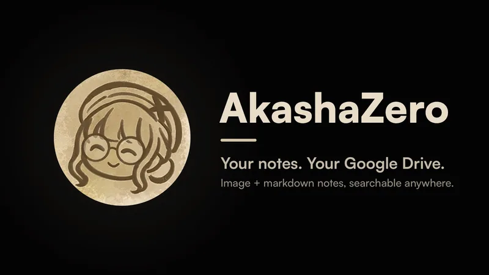
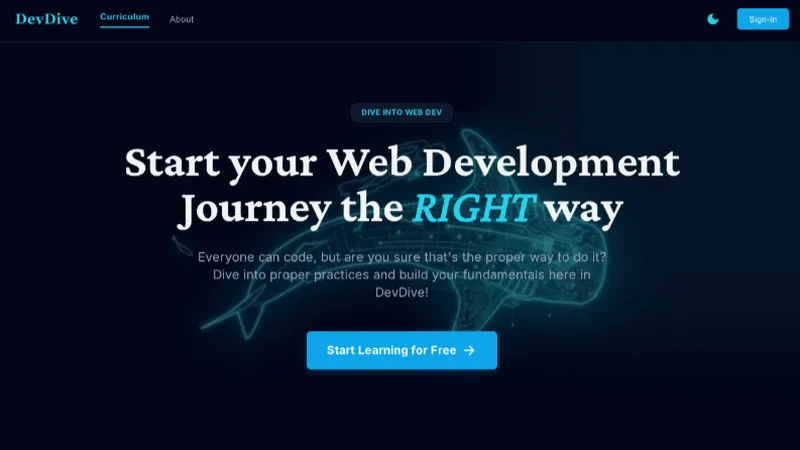
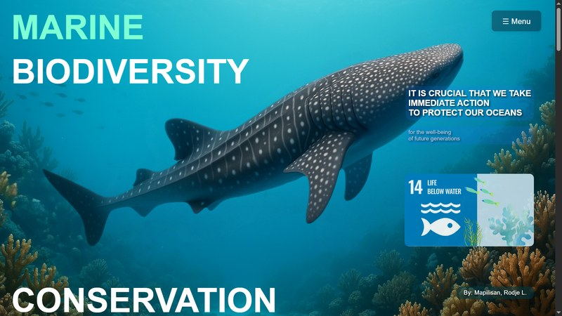
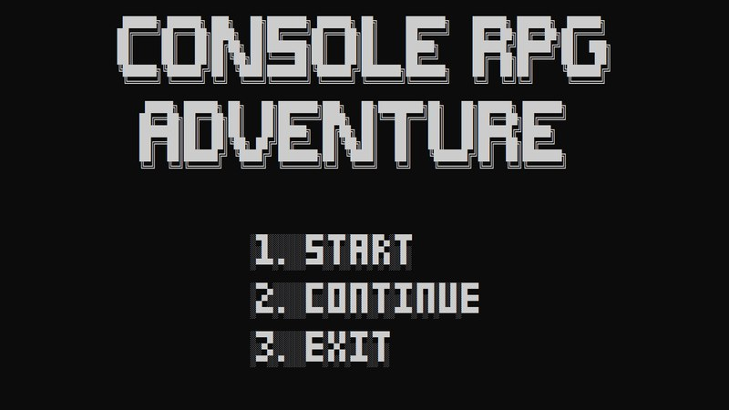
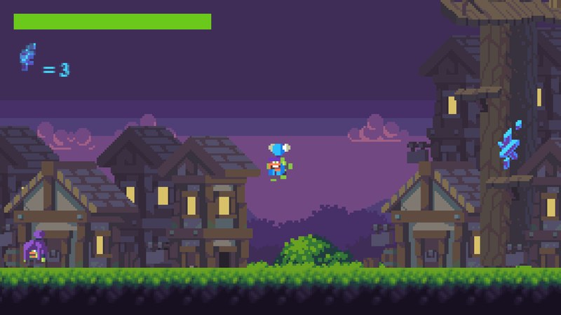
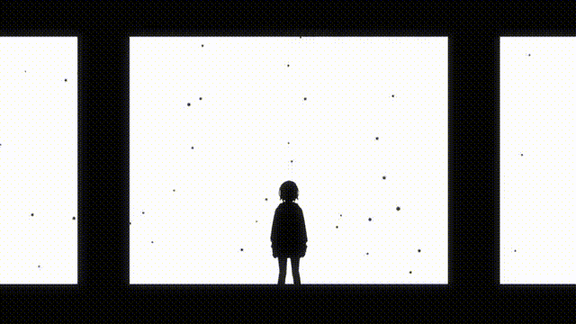
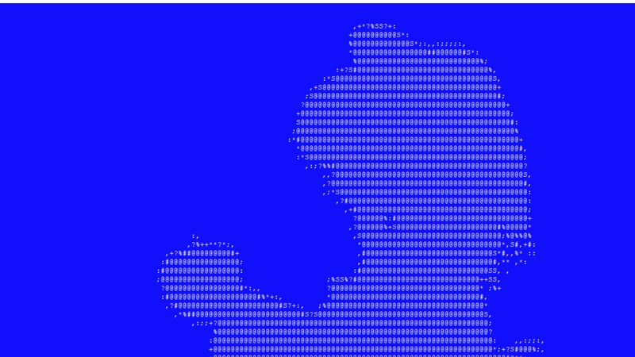

<h2><picture><source media="(prefers-color-scheme: dark)" srcset="assets/icons/star-dark.svg"></picture> Featured</h2>
<table>
<tr>
<td width="410" valign="middle" align="center">

</td>
<td valign="middle">
<h3><picture><source media="(prefers-color-scheme: dark)" srcset="assets/icons/graduation-cap-dark.svg"></picture> <a href="https://github.com/hrodge107/MeetMita">Meet Mita</a></h3>
  

Meta Global AI Developer Hackathon entry. Upload a PDF or photos of your notes and Mita, a 3D anime study companion, turns them into an interactive lesson with recall checkpoints, AI picture cards, and Q&amp;A grounded in your material.

<a href="https://github.com/hrodge107/MeetMita"><b>Repo</b></a>
</td>
</tr>
<tr>
<td width="410" valign="middle" align="center">

</td>
<td valign="middle">
<h3><picture><source media="(prefers-color-scheme: dark)" srcset="assets/icons/library-big-dark.svg"></picture> <a href="https://akasha-zero.vercel.app">AkashaZero</a></h3>
  

An installable PWA for notes that pair an image with markdown, organized as Series → Chapter → Note Card. Every note lives as plain files in your own Google Drive, with background OCR, full-text search, and offline reading.

<a href="https://akasha-zero.vercel.app"><b>Live</b></a>
</td>
</tr>
<tr>
<td width="410" valign="middle" align="center">

</td>
<td valign="middle">
<h3><picture><source media="(prefers-color-scheme: dark)" srcset="assets/icons/code-xml-dark.svg"></picture> <a href="https://github.com/hrodge107/DevDive">DevDive</a></h3>
  

An e-learning platform for HTML, CSS, and JavaScript fundamentals. Structured lessons and quizzes lead into exercises in a built-in IDE that automatically checks both your code and its visual output, plus a free-form playground.

<a href="https://github.com/hrodge107/DevDive"><b>Repo</b></a>
</td>
</tr>
</table>

<h2><picture><source media="(prefers-color-scheme: dark)" srcset="assets/icons/layout-grid-dark.svg"></picture> More Projects</h2>

<picture><source media="(prefers-color-scheme: dark)" srcset="assets/icons/globe-dark.svg"></picture> <b>Web</b> (1)

 

<table>
<tr>
<td width="270" valign="top" align="center">
 
<b><picture><source media="(prefers-color-scheme: dark)" srcset="assets/icons/fish-dark.svg"></picture> <a href="https://mapilisan-obe-marinebiodiversity.pages.dev/">Marine Biodiversity</a></b> 
 
A showcase of Philippine marine life and why it matters.
</td>
</tr>
</table>

<picture><source media="(prefers-color-scheme: dark)" srcset="assets/icons/gamepad-2-dark.svg"></picture> <b>Games</b> (3)

 

<table>
<tr>
<td width="270" valign="top" align="center">
 
<b><picture><source media="(prefers-color-scheme: dark)" srcset="assets/icons/swords-dark.svg"></picture> <a href="https://github.com/hrodge107/ConsoleRPGAdventure">Console RPG Adventure</a></b> 
 
Turn-based console RPG with QTE combat and ASCII art.
</td>
<td width="270" valign="top" align="center">
 
<b><picture><source media="(prefers-color-scheme: dark)" srcset="assets/icons/mountain-dark.svg"></picture> <a href="https://gd.games/games/b6d9f9ad-26b1-4051-983d-e2ae0b0cf65e">Cavern Run</a></b> 
 
My first game from Grade 11, the one that got me coding.
</td>
<td width="270" valign="top" align="center">
 
<b><picture><source media="(prefers-color-scheme: dark)" srcset="assets/icons/book-open-text-dark.svg"></picture> <a href="https://drive.google.com/file/d/1pYCrO9FK41QRGRNH2ahu1oHtjH196IBi/view?usp=sharing">El Filibusterismo VN</a></b> 
 
Visual novel retelling of Rizal's El Filibusterismo.
</td>
</tr>
</table>

<picture><source media="(prefers-color-scheme: dark)" srcset="assets/icons/sparkles-dark.svg"></picture> <b>Just for Fun</b> (1)

 

<table>
<tr>
<td width="270" valign="top" align="center">
 
<b><picture><source media="(prefers-color-scheme: dark)" srcset="assets/icons/apple-dark.svg"></picture> <a href="https://github.com/hrodge107/MasamangMansanas">Bad Apple in Tkinter</a></b> 
 
Bad Apple!! played in a Tkinter window (via CalvinLocke).
</td>
</tr>
</table>

